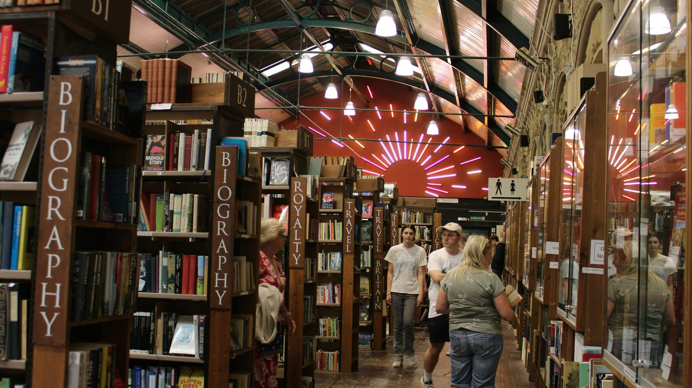
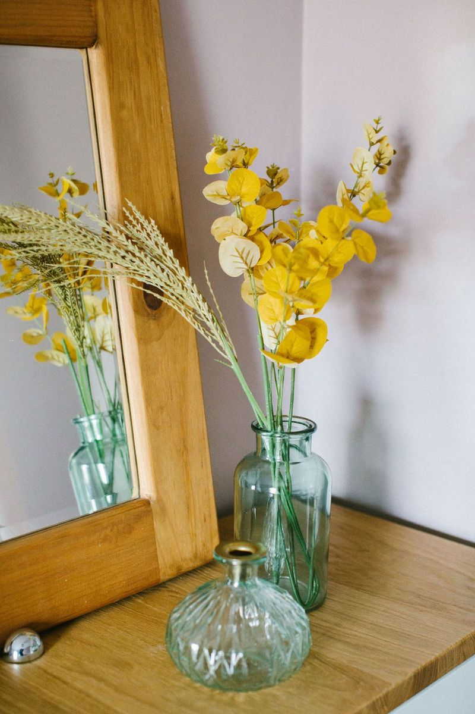
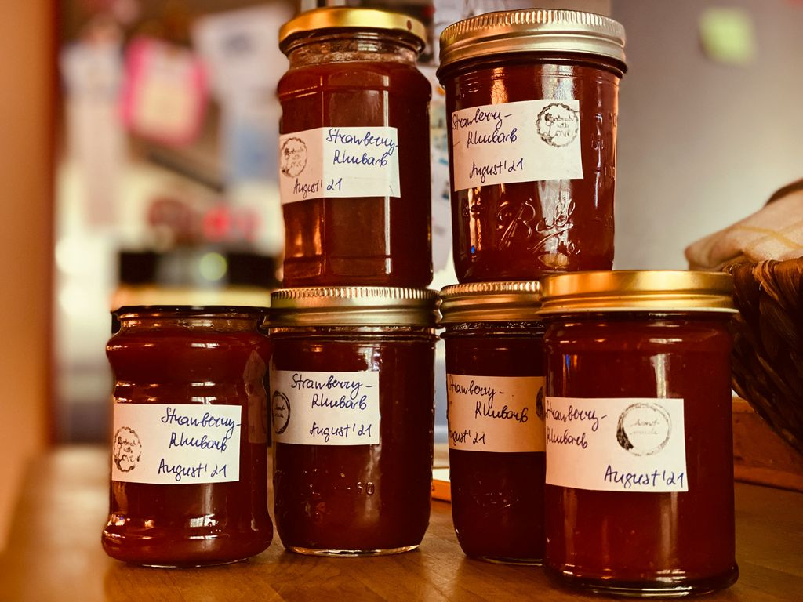
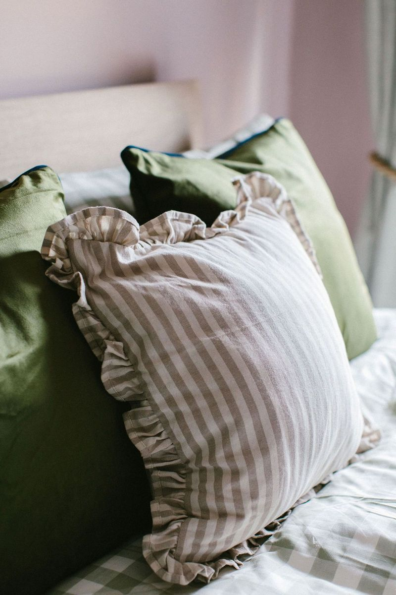
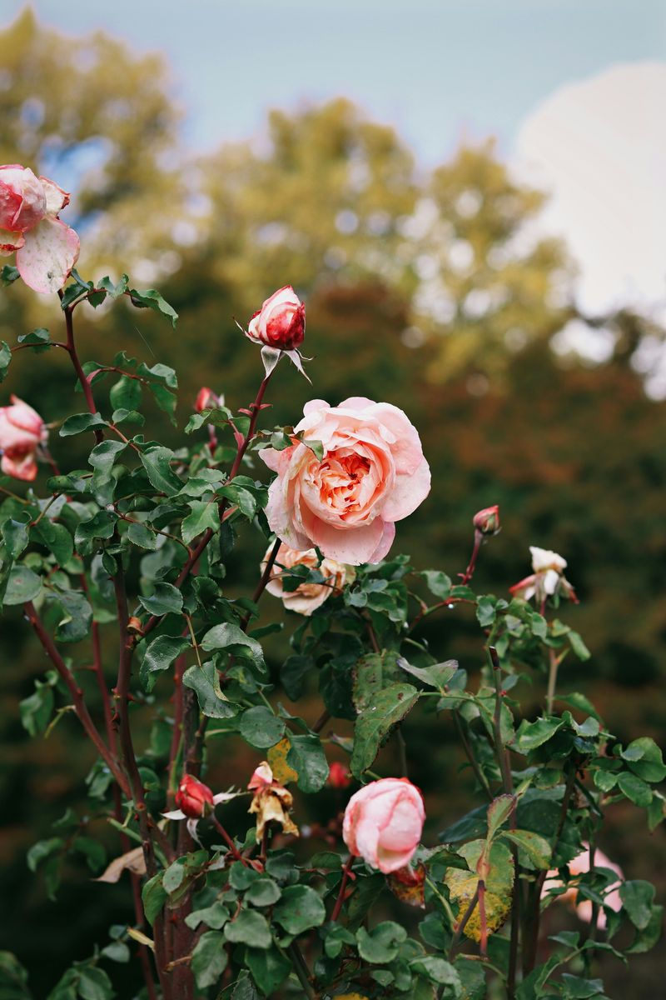

Alnwick is made for slowing down. Everything you need is a short walk from the front door, and the coast is only minutes away when you want sea air.

Here's how we'd spend a weekend at Autumn House, with no alarm clocks required.

#### Friday
## Arrive and *settle in*

Peel off your boots, pop the kettle on and pick up milk from the handy, well-stocked corner shop, less than a minute away.

For dinner, stroll into town to the Adam and Eve, a neighbourhood pub with modern European food built on seasonal, British ingredients.

#### Saturday morning
## Wake *with* the house

Start slowly with a coffee in the armchair, then wander to Barter Books, 400m away. It's one of the biggest second-hand bookshops in the country, set in an old railway station, with a café and an open fire.

Pick up something tasty for later at Turnbulls of Alnwick, our local deli and butcher.

#### Saturday afternoon
## Choose *your* pace

Explore The Alnwick Garden, 500m away, with its water features, cherry orchard and rose gardens, or head out on the paths of Hulne Park (check opening times first).

For something special that evening, book a table at the Treehouse Restaurant in The Alnwick Garden: dinner among the treetops, under twinkling lights.

#### Sunday
## Do *very* little

Drive 12km to Craster for kippers and the clifftop walk to Dunstanburgh Castle, or stop in Alnmouth for some of the best views on the coast. Finish with a pint at The Dirty Bottles before heading home.
