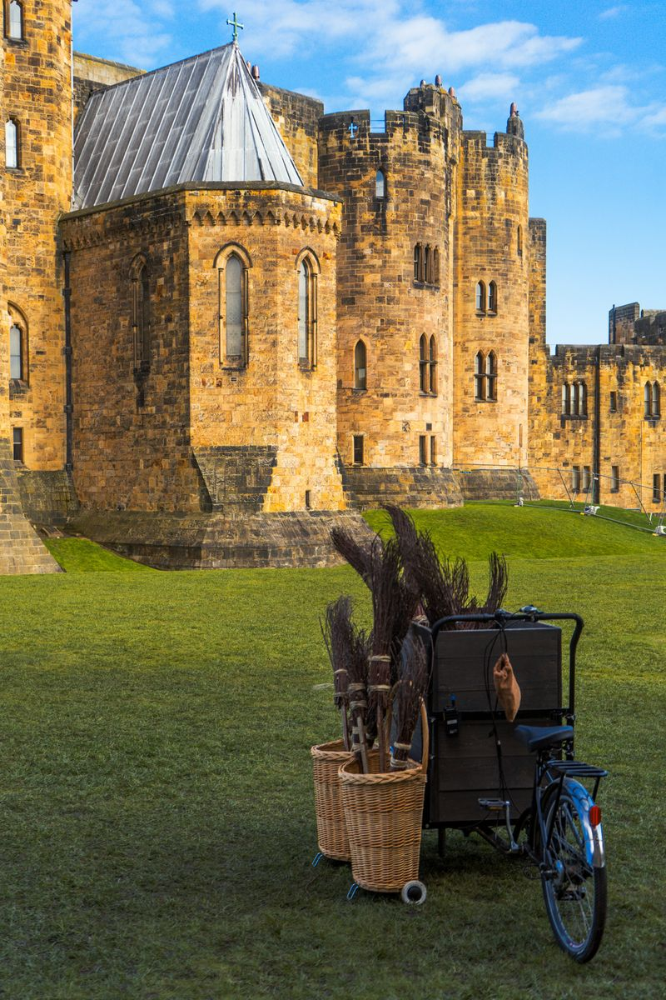
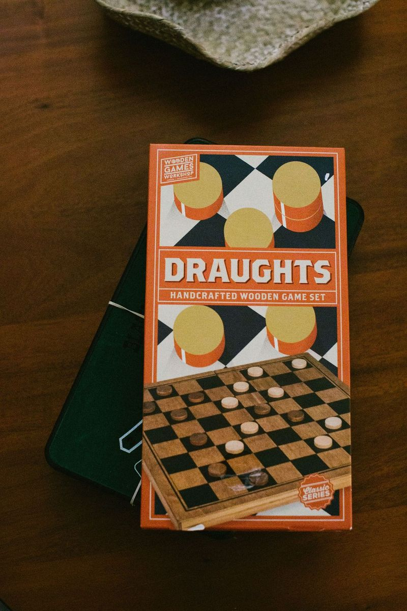
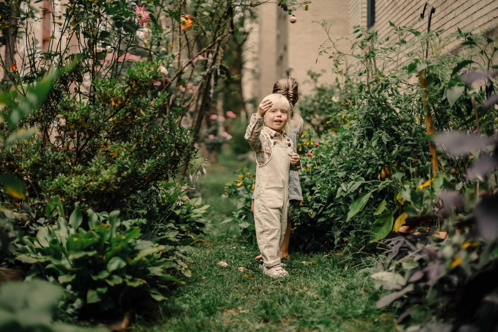

Alnwick is wonderful for families, and so much of it is on foot from Autumn House. Here are our suggestions for keeping little ones busy.

## Castles *and* gardens

Alnwick Castle (1.2km) is where young Harry Potter fans come for broomstick lessons. Next door, The Alnwick Garden (500m) has spectacular water features, and Lilidorei, a magical play village, is a favourite with younger visitors.

## Books *and* films

You can't miss Barter Books, an enchanting second-hand bookshop and café a very short walk away, with a dedicated children's area. For a rainy afternoon, The Alnwick Playhouse is an independent cinema and theatre.

## Swimming *and* fresh air

Willowburn Leisure Centre, just round the corner, has children's swimming. When the sun's out, Hulne Park has easy, paved walks through fields and forest, and Alnmouth's beach is a short drive away.

For more ideas, [North East Family Fun](https://www.northeastfamilyfun.co.uk/search?q=ALNWICK) is a great local blog.
