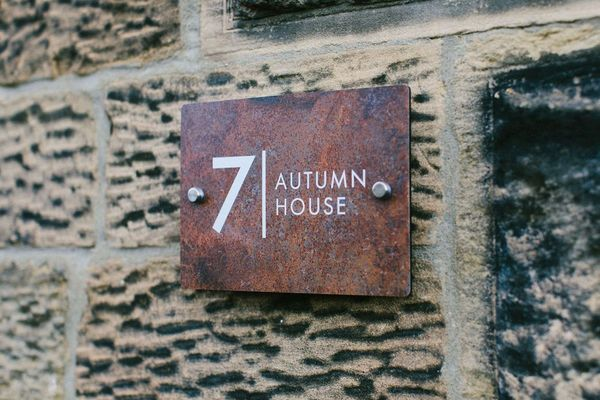
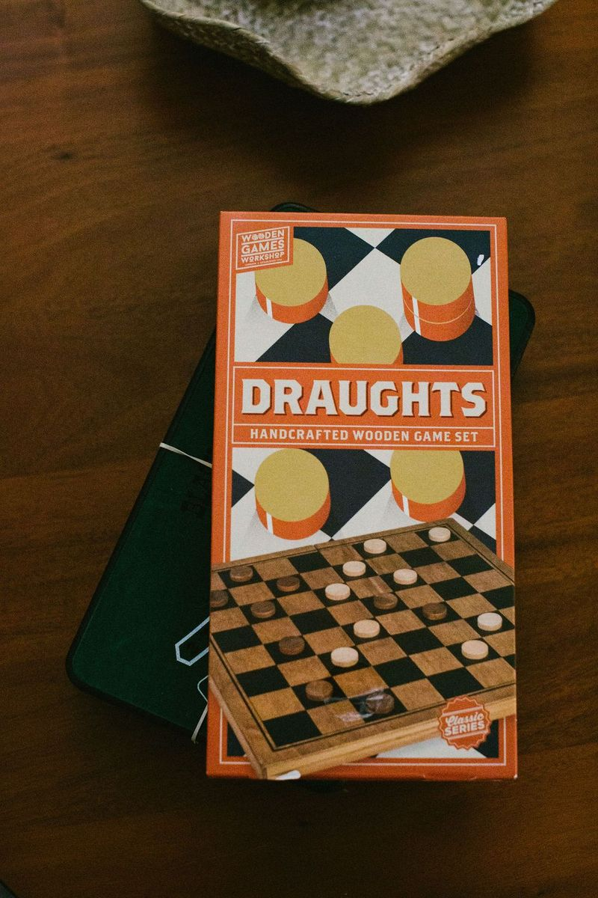

We're passionate about doing what we can for the planet and our corner of Northumberland. From bamboo toilet rolls by Bumboo to refillable, vegan, UK-made cleaning products, we try to tread lightly. Here are a few ways you can join in.

## Leave *the car*

Ditch the car, save on parking and head out on foot. The castle, The Alnwick Garden, Barter Books and the town centre are all within a short walk of the front door. Borrow one of our bags for life from the cupboard under the stairs before you hit the shops.

## Shop *local*

Try a local treat or tipple from the town centre. We love Turnbulls of Alnwick for food with very few food miles. Finished your holiday read? Take it to Barter Books at the bottom of the street and swap it for another.

## Switch *off*

Swap the laptop for an evening of games: draughts is a simple game for two, and our mini casino set will keep a small group busy for hours. Or curl up with our recycled wool throw from TBCo and a good book.

## Little *habits*

Separate your waste, making sure recycling is clean and dry, and set a timer when you switch on the heaters, the stove or the underfloor heating. They're easy to forget!
