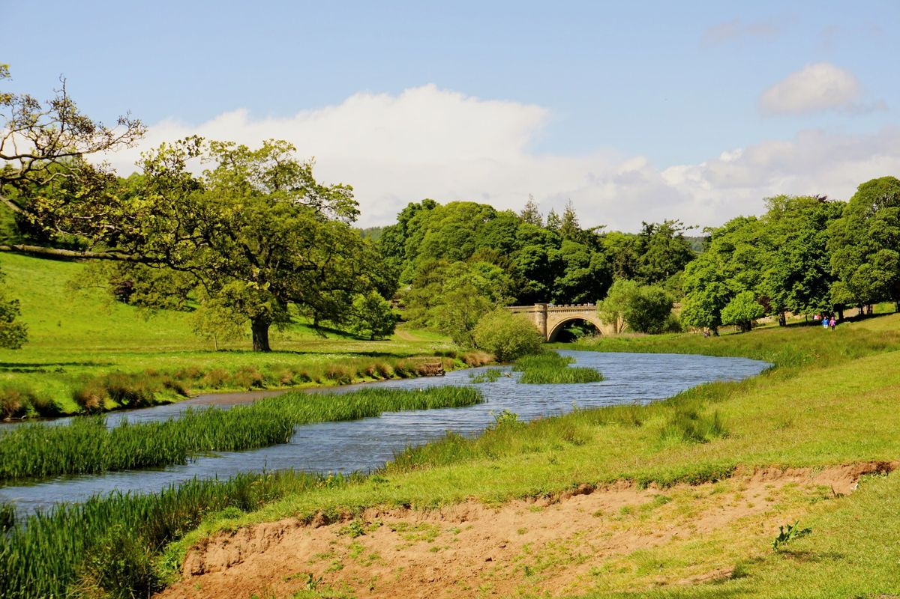

You don't need to go far for a good walk from Autumn House. Here are some of our favourites, from an easy amble to a bracing coastal stretch.

## Hulne *Park*

Part of the Duke of Northumberland's estate, right on the edge of town. A series of marked, paved paths takes you through fields, forest and along the river. It's popular with families. Check opening times before you go.

## Craster to *Dunstanburgh*

Drive 12km to Craster, famous for its kippers, then follow the clifftop path to the dramatic ruins of Dunstanburgh Castle. Come back for lunch in the village.

## Alnmouth *beach*

A short drive from Alnwick, Alnmouth has some of the best views on the coast. Walk around the estuary, or take a gentle stroll along the beach, whatever the weather.

## Warkworth *and* Thrunton

Charming Warkworth is perfect for river strolls, a historic castle and handmade chocolate treats. Inland, Thrunton Forest has miles of trails for hiking, running and biking.

## Birds *by the sea*

Bring binoculars: an outstanding range of species can be spotted along the coast, especially around Hauxley Nature Reserve.
