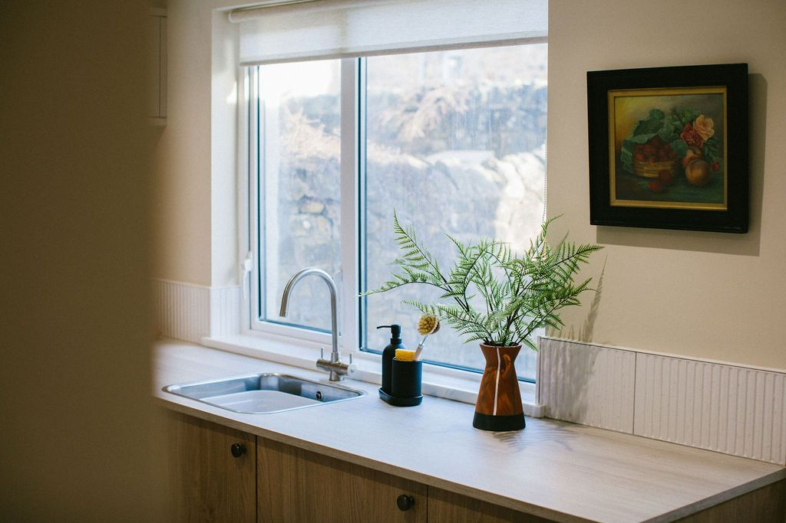
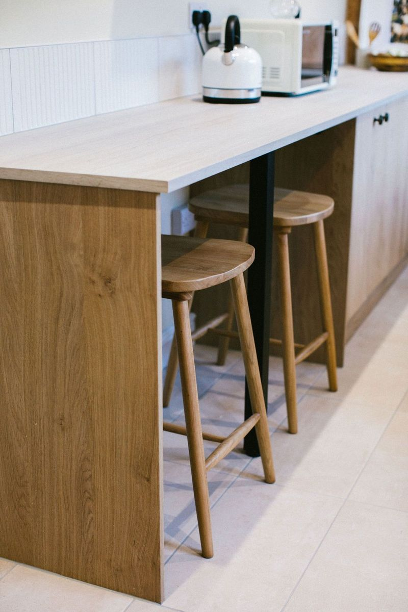

There's plenty to eat within a ten-minute walk of Autumn House, and even more a short drive away. These are the places we keep going back to.

## Something *special*

**The Treehouse Restaurant, The Alnwick Garden.** Dine under the woodland canopy among twinkling lights, or by the log fire when the weather suits. The menu is modern British, built on seasonal produce.

## Something *local*

**Adam and Eve, Alnwick.** An elevated neighbourhood pub serving modern European dishes, with a focus on British farmers and fresh, seasonal, sustainable ingredients.

**Mumbai of Alnwick.** A long-running and reliable spot when you're craving Indian food. It can be busy, even on weeknights.

## Further *afield*

**Embers, Embleton.** A casual beachside hut serving wood-fired pizzas, perfect for sunset dinners. It's seasonal, so check opening times.

**The Joiners Arms, Newton-by-the-Sea.** Worth the short trip. We love the sharing platters, a chance to try North East classics like stotties, pies and local fish. There's a good children's menu and a beer garden for warmer days.

## Something *sweet*

**The Running Fox Café** (Shilbottle, Felton and Longhoughton). This small chain of cafés knocks it out of the park with sweet treats. We can't resist a slice of something after a long ride or trail run. Go hungry.
